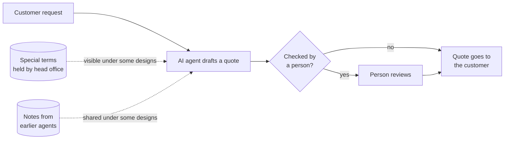

<h1> Global Collaboration with AI Agents</h1>

**GCA Simulation** · *a multi-agent simulator of companies where people and AI agents share the work*

[Report](reports/first_round_report.md) • [Experiment plan](experiments/agent_pilot_plan.md) • [Assumptions](evidence/assumptions.yaml) • [Citation](CITATION.cff)

## Overview

When a company hands part of its work to AI agents, someone has to decide which tasks the agents take, what they may do on their own, who checks their work, and who can see which information. Each of these choices changes how much the company gets done, how much time goes into checking, and who pays when an agent gets something wrong.

**Global Collaboration with AI Agents (GCA)** is an economics and management research project on these choices. It is funded by the 2026 CEMS Philippe Louvet Innovation Grant and comes with a cross-school course for the CEMS alliance of business schools, in which student teams run a simulated multinational company where AI agents do part of the work. This repository holds the project's simulator, together with an experiment that tests a real AI model on the same tasks.

## The quotation exercise

A management design fixes these choices. The simulator plays out a week of work under a given design and shows what follows, from wrong quotes that reach customers to the time people spend on review.

In the first exercise, AI agents draft price quotes for regional sales teams, and people review some of them. Some customers have special terms agreed with head office, and not every role can see them.

## Results

- **Information matters more than monitoring. Who can see the customer's agreement matters more than who reviews it.** In the simulator, the design that lets the agent and head office read every agreement had the fewest wrong quotes under every combination of assumptions tried. In the experiment, the agent that could see the agreement got all 120 quotes right and ignored a wrong note.
- **A shared notebook cuts both ways.** When the agent could not see the agreement, it followed a note about the customer most of the time, whether the note was right (14 of 15) or wrong (19 of 30).
- **The model's caution limited the damage.** It passed most quotes it could not verify to a person. The wrong note reached the customer in 7 of 30 cases, against 3 of 30 without shared notes. The experiment is too small to say this difference is real.
- **Real evidence changed the simulator's conclusions.** Putting the experiment's numbers into the simulator changed 14 of its 135 comparisons.
- **The largest gap is human behaviour.** No data used here says how often a human reviewer catches a mistake or how long a review takes. Several conclusions depend on those guesses.

The full account, written for a reader new to the project, is in [`reports/first_round_report.md`](reports/first_round_report.md). The detailed reports are in `reports/`.

## Install and run the tests

Requires Python 3.13.

    git clone https://github.com/dingyingliu/gca-simulation.git
    cd gca-simulation
    python3 -m venv .venv
    source .venv/bin/activate        # Windows: .venv\Scripts\activate
    python -m pip install -r requirements.lock
    python -m pytest

Three tests are skipped unless the BPI Challenge 2020 log is downloaded (see `data/SOURCES.md`). The log analysis also needs the optional install `pip install -r requirements-process-mining.lock`.

## Repository map

| Folder | What is in it |
|---|---|
| `gca_sim/simulator/` | The research simulator |
| `gca_sim/pilot/` | The experiment harness: tasks, prompt, model client, spending guard, scoring, analysis |
| `gca_sim/demo_replica/` | An exact Python replica of the course's original demonstration, checked against its JavaScript |
| `gca_sim/process_logs/` | A reader for the BPI Challenge 2020 event log |
| `specs/simulated_weeks/` | The frozen simulated weeks: development and held-out |
| `evidence/` | The assumptions file and one record for every number's source |
| `experiments/` | The experiment plan and run scripts, and the AI model's recorded answers |
| `reports/` | Reports, tables and figures |
| `tests/` | The test suite |

## Licence

The code is under the MIT licence ([`LICENSE`](LICENSE)). Files derived from the BPI Challenge 2020 log (Boudewijn van Dongen, Eindhoven University of Technology, 4TU.ResearchData, DOI 10.4121/uuid:3f422315-ed9d-4882-891f-e180b5b4feb5) are under CC BY-NC 4.0, and the log itself is not included. Excerpts from τ-bench are under its MIT licence. PM4Py (AGPL-3.0) is not included and is used only by the optional log analysis. Details are in [`LICENSE-DATA.md`](LICENSE-DATA.md).
