# The GCA simulator, first round of experiments: what was done and what it showed

Written by Claude Code (the builder) for Dingying Liu, the project's principal investigator, 3 October 2026 (UTC). For a reader who is new to the project.

## 1. Summary

**What this is.** A course is being designed in which student teams run a simulated company where AI agents do part of the work. The teaching tool is a simulator: a team chooses who may do what and who checks whom, and the simulator shows what follows. Until now the simulator existed as a design and a demonstration with invented numbers. This round built the first working pieces and tested them. It took under a day of machine time, on 2 and 3 October 2026, and cost nothing in model fees.

**What was done, in five steps.**

1. The demonstration was rebuilt exactly, as a reference point (section 4).
2. One real company record, a university's travel-claim approvals, was studied to see what such records can tell a simulator (section 5).
3. A research version of the quotation simulator was built, in which nobody can see the right answer, and three management designs were compared in it (section 6).
4. A public set of recorded AI customer-service conversations was checked as a possible source of evidence (section 7).
5. A first experiment was run with a real AI model: 504 quotes drafted by an AI agent under four conditions (section 8).

**The main findings.**

- **Who can see the customer's agreement matters more than who reviews.** In the simulator, the design that lets the agent and head office read every agreement has the fewest wrong quotes in every combination of guesses we tried. In the experiment, when the AI agent could see the agreement it got all 120 quotes right and ignored a wrong note.
- **A shared notebook cuts both ways.** When the agent could not see the agreement, it followed a note about the customer most of the time, whether the note was right (14 of 15) or wrong (19 of 30).
- **This AI model was cautious, and that limited the damage.** It passed most quotes it could not verify to a person. So the wrong note ended up on a quote sent to the customer in 7 of 30 cases, against 3 of 30 without shared notes. The experiment is too small to say that this difference is real.
- **Real evidence changed the simulator's conclusions.** Putting the experiment's numbers into the simulator changed 14 of its 135 comparisons. One conclusion no longer holds, and two became firmer.
- **The biggest gap is people.** Nothing we used says how often a human reviewer catches a mistake or how long a review takes. Those are still stated guesses, and several conclusions depend on them.

**How far to trust it.** Everything here is an early result. The simulator's numbers follow from stated guesses. The experiment used one free, mid-sized AI model on invented tasks. Two independent AI reviewers checked the work in thirteen rounds and raised 85 points; the corrections that mattered are in section 9. Section 10 separates what is solid from what is assumed, and answers the question of how good a simulator built from one company's record can be.

## 2. Background

### 2.1 The course and the simulator

Global Collaboration with AI Agents (GCA) is a proposed online course for the CEMS alliance of business schools. Student teams from several schools run a simulated multinational company in which AI agents do part of the work. One student plays head office, others play regional managers, and each sees different information.

The teaching tool is a **simulator**. In each exercise the team chooses a management design:

- which work goes to people and which to AI agents;
- who is allowed to do what;
- who checks whose work;
- who can see which information.

The simulator then plays out a week of work under that design and shows the consequences: how long customers waited, how much checking people had to do, and how many mistakes reached customers. The team traces each mistake back to the rule that allowed it, changes the design, and runs the same week again. Students are marked on their reasoning, not on whether the simulated company did well.

The first exercise is about **customer quotations**. Regional sales teams use AI agents to draft price quotes. Head office notices that one customer received two quotes with different terms. Students decide what the agents may send without a check, which quotes a local manager must review, and who can see the terms agreed with each customer.

### 2.2 What existed before this work

Before this round there were three things: the course design, a technical plan for the simulator, and a demonstration web page ("One week in the course") that walks through the quotation exercise with invented numbers. The demonstration looks like a simulator, but its outcomes were written by hand. Nothing had been tested.

### 2.3 What this round set out to do

The aim was a first chain of working evidence that the simulator idea is feasible, and an honest account of what that evidence rests on. Five pieces were planned:

1. rebuild the demonstration exactly, as a fixed reference point;
2. study one real company log, to see what real approval work looks like in data;
3. build a research version of the quotation simulator and compare three management designs with it;
4. check whether a public set of recorded AI conversations could serve as evidence about AI agents;
5. run a first controlled experiment with a real AI model.

The grant application for the course was submitted on 15 September 2026 and is frozen. None of this work changes it.

## 3. How the work was run

Three AI agents worked under Dingying's direction, each with one job.

- **The builder** (Claude Code) wrote all the code, ran every experiment and wrote the reports. This report is the builder's.
- **Two reviewers** (a second Claude, and Codex) checked each batch of work independently. Neither saw the other's review. The builder read both reviews together and recorded what it did about every point.
- **Dingying** decided anything the builder and the reviewers disagreed on, and every question of money or scope.

A few rules were fixed from the start, and they shape how to read everything below.

- **Every number carries a label.** *Observed* means counted in real data. *Fitted* means estimated from a sample. *Assumed* means a stated guess. *Illustrative* means invented for a demonstration.
- **Guesses are written down before results are seen.** Where nothing is known, the guess is a range, not a single value, and conclusions are tested across the whole range.
- **Some data is held back.** Part of each experiment is set aside, used once at the end, and never used to adjust anything.
- **Everything is logged.** A lab log records each step with its time, and corrections are added as new entries instead of rewriting old ones.

Over the round the reviewers raised 85 points in thirteen review rounds. Six were marked as blocking, meaning work on that part stopped until they were fixed. Section 9 lists the corrections that changed results.

## 4. Step one: rebuilding the demonstration

### What was done

The demonstration page contains a small program: twenty invented quote requests in three markets, and three management designs. We copied that program into Python and checked that our copy gives exactly the same output as the original, line for line, for all three designs. The copy is a reference point only. It is kept apart from the research model.

The three designs appear throughout this report:

| Design | In one sentence |
|---|---|
| **Review every quote** | A regional lead checks every quote before it goes out. |
| **Release within shared limits** | The agent and head office can read the register of customer agreements; the agent sends what passes its own check, and only requests beyond company policy go to head office. |
| **Refer local exceptions** | The agent sends ordinary quotes itself and refers the ones it recognises as special to a local lead. |

### What it showed

The demonstration contains a rule that staff "go round" a slow check: if a quote waits more than three days for review, the sales team sends it unchecked. The case description for the course says not to assume this. So in our copy the rule is a named assumption that is switched off unless asked for.

Switching it off changes the demonstration's own story (all numbers *illustrative*):

| Review every quote | Wrong quotes reaching customers | Average days to customer | Quotes sent with no approval |
|---|---|---|---|
| With the "go round a slow check" rule, as published | 4 | 1.7 | 5 |
| Without it | 2 | 2.1 | 0 |

With the rule off, reviewing every quote has the same two wrong quotes as the shared-limits design and is simply slower. Part of the demonstration's case against reviewing everything rests on that one rule.

### Why the demonstration cannot be the research model

The demonstration secretly knows the right answer. It sends each quote down a route chosen by what kind of quote it truly is, and whether a reviewer catches a mistake is written in by hand for each quote. A real organisation does not know which quotes are the special ones; that is the whole difficulty. The research model in section 6 was therefore built from scratch, so that nobody in it can see the right answer.

## 5. Step two: what a real company log can tell us

### The data

We used a public data set called **BPI Challenge 2020, Domestic Declarations**, released by Eindhoven University of Technology for research. It is the real, anonymised record of 10,500 travel expense claims at a university, from 2017 to 2019: 56,437 recorded steps in all. An employee submits a claim. Administration, sometimes a budget owner, and a supervisor approve or reject it. Then it is paid. Its licence allows research use but not commercial use.

It is not about quotations. We chose it because it is a real approval chain with roles, which is the closest public thing to "who checks what".

### What the claims go through

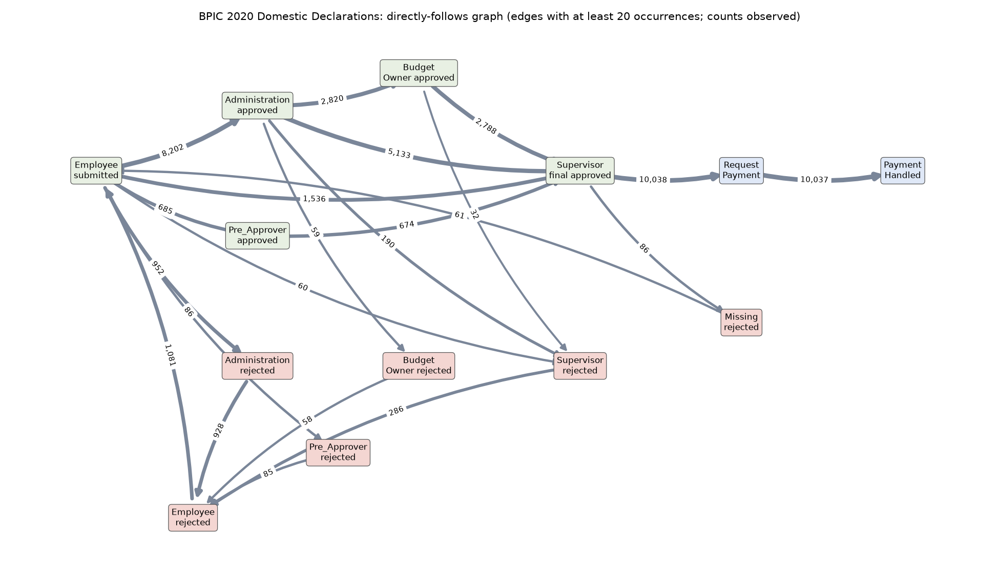

*How to read it: follow the thick arrows from left to right. Most claims go from "submitted" to "administration approved", then to the supervisor, then to payment. The thin arrows running down and back are rejections: a rejected claim returns to the employee, who usually submits it again. All counts observed.*

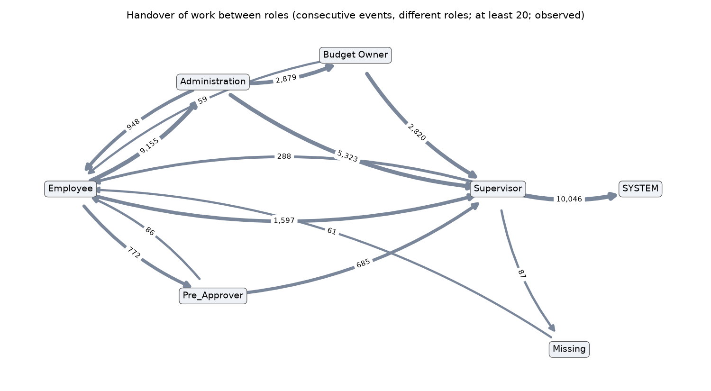

*How to read it: the same flow, drawn between roles. The employee hands 9,155 claims to administration, which passes them to the supervisor directly (5,323) or through the budget owner (2,879). All counts observed.*

Three routes cover 80% of claims. Rejection is rare at the later steps: administration rejects about 10% of what it sees, the budget owner 2% and the supervisor 3%. A rejected claim is resubmitted four times in five.

### How long steps take, and why that is not "review time"

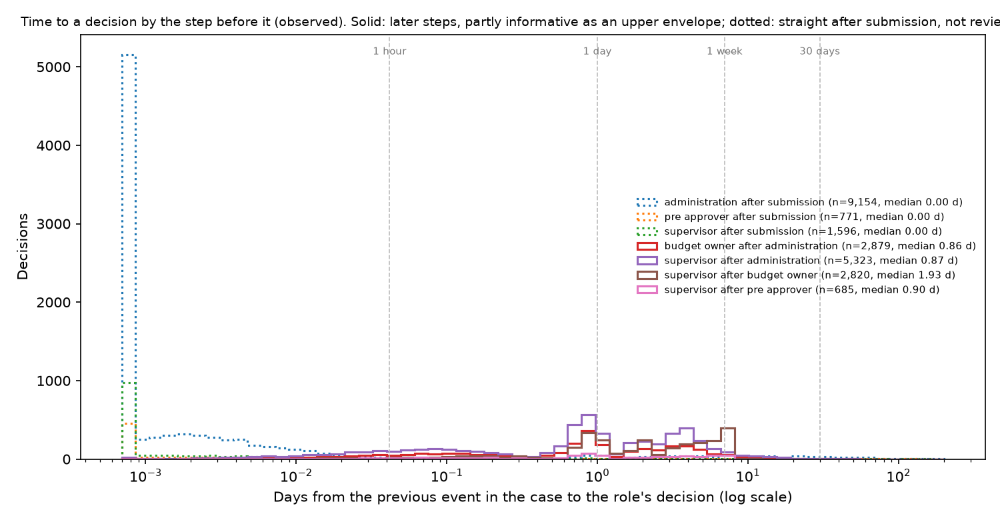

*How to read it: each line is one kind of approval. The horizontal axis is time since the previous step, stretched so that minutes and weeks both fit. The dotted lines pile up at the far left: first checks are recorded within a minute of submission. The solid lines sit around one day. All observed.*

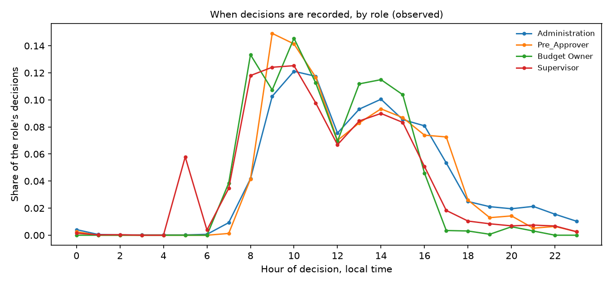

*How to read it: decisions are recorded in office hours, with a dip at lunch. So the day or two between steps is mostly evenings, nights, weekends and other work, not time spent looking at the claim. All observed.*

The later approvals typically come 0.9 to 1.9 days after the step before. That figure is the time *between two recorded events*. The log has no record of when someone started looking at a claim, so it cannot tell us how long a review takes, nor how many reviews a person can do in a week.

### Does a bigger claim get more checking?

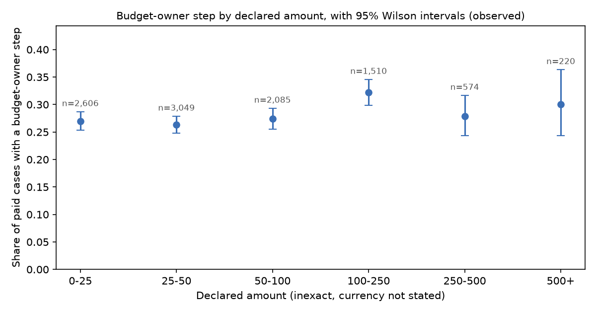

*How to read it: each dot is a band of claim sizes; the bars show the uncertainty. The share is about the same in every band (26% to 32%). In this log a larger claim is not checked by more people. All observed; the amounts in the public file are deliberately inexact.*

### What the log can and cannot give the simulator

Before measuring anything, we wrote down for each quantity the simulator needs whether this log could supply it.

| What the simulator needs | Can this log supply it? |
|---|---|
| How long a reviewer takes to respond | Partly: an upper limit that includes waiting, nights and weekends |
| How much working time a review takes | No |
| How many reviews one person can do in a week | No |
| The chance that a reviewer catches a mistake | No. A rejection rate is not that: the log does not say which claims were actually wrong |
| How often a check sends something back | Yes: 2% to 11% depending on the step |
| How often people go round a slow check | No |
| How many mistakes reach the end | No |

So the log supplied a few plausible ranges and a clear list of what such logs cannot tell us. Everything on the "No" lines stays a stated assumption in the model.

### A correction

The data covers two years. An early version of our report said the 2017 process "carried over" to 2018, because a process map built from 2017 fitted the 2018 claims well. A reviewer asked for a harder check, and it showed the claim was wrong: the 2017 map fitted only because it was loose enough to fit almost anything. In fact the two years ran differently. In 2017, two departments sent most claims straight to a supervisor. In 2018 the whole university sent every claim through administration first. The claim was withdrawn.

## 6. Step three: a research version of the quotation simulator

### What it is

A program that plays out one working week of quotation requests: twenty requests across three markets. An AI agent drafts each quote. Depending on the design, a person may check it. Then it goes to the customer. At the end of the week the program counts how many quotes reached customers with wrong terms, how long customers waited, and how many checks people had to do.

Four things make it a research model and not a demonstration.

1. **Nobody inside it can see the right answer.** The program keeps three things apart: what is true (the terms each customer really has), what each role can see under the chosen design, and what each role decides. The agent, the routing rules and the human reviewers decide only from what they can see, and they can be wrong. A test plants a decision that tries to peek at the truth and checks that the program stops it.
2. **Company rules are hard limits.** A quote beyond the written policy cannot be sent by an agent or a regional lead. The program sends it to head office instead. We call this the *policy gate*.
3. **The same luck for every design.** Chance plays a part: whether an agent misreads a request, whether a reviewer notices a mistake. The program gives every design exactly the same run of luck, so a difference between two designs comes from the designs.
4. **Every decision leaves a trace.** The log records who decided, what they could see at that moment, which rule allowed it, and which assumption shaped it.

### What goes in: stated guesses, each with a range

The model needs 26 quantities. Examples: how often an agent misreads a standard request; how often a reviewer who knows the right terms catches a wrong draft; how many working days a regional lead needs for one review. We had evidence for none of them. So each got a range, written down with the date before any result was computed.

To see what follows from those guesses, the program was run with 64 different combinations of values spread evenly over the ranges. Each combination was run 64 times with different luck, on five different weeks. That is 20,480 simulated weeks for each design.

Two kinds of uncertainty are kept apart throughout:

- **Luck.** Two runs of the same week with the same values differ. More runs shrink this.
- **Not knowing the values.** The guesses could be wrong anywhere in their ranges. More runs do not shrink this. Only evidence does.

### What came out

*Every number in this section is a result of the model under assumed ranges. None is a measurement of a real company.*

| Each week, out of 20 quotes | Review every quote | Release within shared limits | Refer local exceptions |
|---|---|---|---|
| Quotes with wrong terms reaching customers | 2.9 (2.1 to 3.9) | 1.3 (0.8 to 1.9) | 3.5 (2.4 to 4.6) |
| Average days until the customer has the quote | 3.1 (1.2 to 5.1) | 1.1 (0.7 to 1.4) | 1.5 (1.1 to 1.9) |
| Checks done by people | 20 by regional leads, 1 by head office | 4 by head office | 6 by regional leads, 4 by head office |

*The first number is the average. The range in brackets covers most of the 64 combinations of guesses (from the 5th to the 95th percentile). These are the results after the experiment's numbers were put in; the last part of this section says what that changed.*

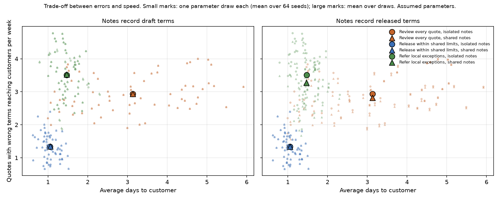

*How to read it: the three colours are the three designs. Each small mark is one of the 64 combinations of guesses, and the large marks are the averages. Circles are agents with separate notes, triangles agents with shared notes. Blue ("release within shared limits") sits at the bottom left: fewest wrong quotes and fastest. Green ("refer local exceptions") sits highest: most wrong quotes. Orange ("review every quote") stretches far to the right: how slow it is depends on how long a review takes, which nobody has measured. The left panel assumes that an agent's note records what it drafted; the right panel that it records what was finally sent.*

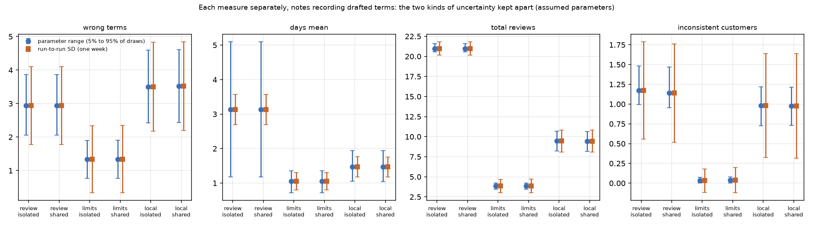

*How to read it: four measures, one panel each. Along the bottom are the three designs, each with separate ("isolated") and shared notes. The blue bar shows how far the result moves when the guesses change. The orange bar shows how far a single week moves by luck alone. For wrong quotes the orange bars are as long as the gaps between designs. A team that looks at one simulated week can be misled by luck, which is why the course design has teams run the same week again.*

Why the designs come out this way:

- **Release within shared limits.** The agent and head office can read every region's register of agreements, so quotes for customers with a written agreement are drafted correctly in the first place. Two kinds of mistake remain. Nobody can catch a promise that was only made by word of mouth. And no person reads the standard quotes.
- **Review every quote.** A regional lead catches most mistakes about its own region's customers. It misses mistakes about another region's customers unless it thinks to ask. And it reviews twenty quotes a week, so its queue can grow long.
- **Refer local exceptions.** The agent must recognise by itself which quotes are special. It recognises fewer than half of them. Of the rest, those whose request mentions an agreement are mostly passed to head office, and the others go out with standard terms.

### Which conclusions are firm, and which depend on the guesses

We call a conclusion firm when it comes out the same way in at least 95% of the 64 combinations.

**Firm:**

- "Release within shared limits" has the fewest wrong quotes: fewer than both other designs in all 64 combinations.
- It is also the fastest: faster than "refer local exceptions" in all 64, and faster than "review every quote" in 62 of 64.
- "Review every quote" needs by far the most checking: 21 checks a week against 10 and 4.
- "Review every quote" is slower than "refer local exceptions" in 61 of 64 combinations.

**Depends on the guesses:**

- Whether "review every quote" has fewer wrong quotes than "refer local exceptions". It does in 84% of combinations, which is below our bar. It depends mostly on how often a customer's request mentions that an agreement exists.
- The speed results reverse in a few combinations, all of the same kind: regional leads who review quickly, and a head office that is slow and overloaded.

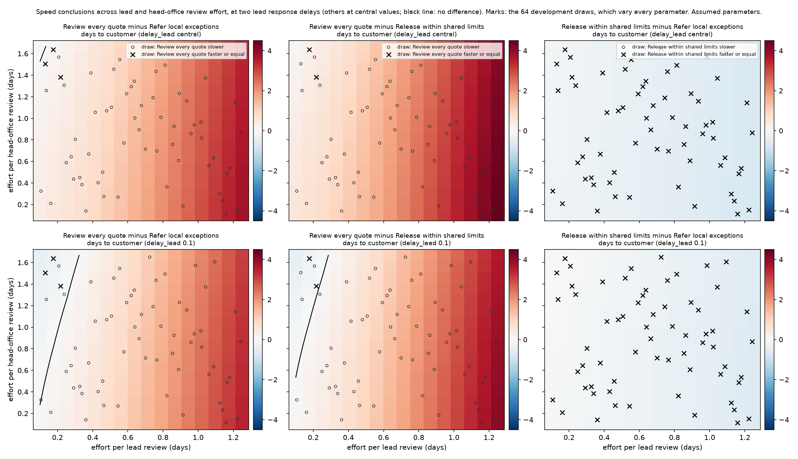

*How to read it: each panel is a map. From left to right a regional lead needs longer for one review. From bottom to top head office needs longer for one review. Red means the first-named design is slower, blue that it is faster, and the black line is where they are equal. In the top row a lead's answer then takes half a day to go out; in the bottom row only an hour or so. The marks are the 64 combinations: a cross where the first-named design was faster or equal in that combination, a circle where it was slower. In the top row the first two panels are red almost everywhere: reviewing every quote is the slower design. In the bottom row a blue sliver appears on the left: when leads review quickly and head office is slow, reviewing every quote is the faster design.*

So the speed ranking depends on how long reviews take, and on that we have no evidence at all.

### Does it matter whether agents share their notes?

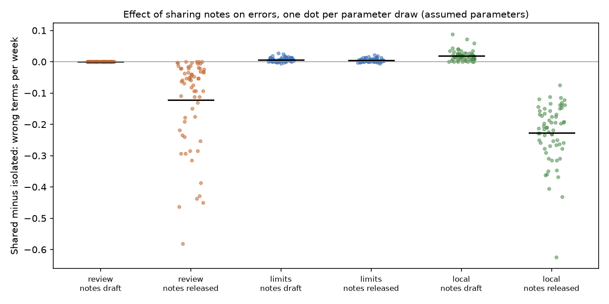

*How to read it: a dot above the grey line means sharing notes produced more wrong quotes in that combination; below the line, fewer. There are two columns for each design: one where notes record what the agent drafted, one where they record what was finally sent after any correction.*

In every design the difference is small: under a quarter of a quote per week, when one week varies by more than a whole quote from luck alone. When notes record what the agent drafted, sharing changes almost nothing. When notes record what was finally sent, a reviewer's correction travels with the note, and sharing helps a little in two of the designs.

What sharing does change is the pattern. Quotes to the same customer agree with each other more often, whether they are right or wrong. That matters for the course's opening case, which starts from a customer who received two quotes with different terms: consistent is not the same as correct.

### The demonstration's best design became the worst

On the demonstration's own week, the demonstration page shows "refer local exceptions" with one wrong quote, the fewest of the three. In the research model the same design on the same week has about 4 (2.7 to 5.1) wrong quotes, the most of the three, in every one of the 64 combinations. The demonstration could send each special quote to the right person because it knew which quotes were special. Once the agent has to recognise them from what it can see, most slip through.

### What the experiment in section 8 changed

The experiment measured four things the model had only guessed, and tested two rules it had built in.

| What the model assumed about the agent | Guess | What the experiment found |
|---|---|---|
| It gets the term wrong although it can see the agreement | up to 20% of the time | 0 of 60; so at most about 6% |
| It passes a quote to a person when it cannot verify the terms | 10% to 80% | 55 of 60; so 82% to 98% |
| It uses a note when it cannot see the agreement | 9% to 100% | 42% to 100% |
| Once it has used a note, it never passes the quote on | a fixed rule | wrong: it did so in 13 of 24 cases |
| A reader looks only at the newest note | a fixed rule | could not be tested |

The rules for feeding these numbers into the model were written down before the experiment's main run. With the new numbers the comparison was run again. 14 of 135 comparisons changed their verdict:

- **One conclusion no longer holds.** Before, "review every quote" had fewer wrong quotes than "refer local exceptions" in 95% of combinations. Now it is 84%. The reason is the agent's caution: an agent that passes on nearly everything it cannot verify makes "refer local exceptions" safer than we had guessed.
- **Two became firm.** "Shared limits" is faster than "refer local exceptions", and "review every quote" is slower than "shared limits".
- **The main one did not move.** "Shared limits" still has the fewest wrong quotes, and now fewer than before (1.3 a week, down from 1.7).

Because one rule could not be tested, the comparison was run once more with that rule turned to its opposite extreme. No comparison of designs on wrong quotes changed.

### A last check on fresh weeks

From the start, four invented weeks were kept aside and never used. At the very end the firm conclusions were written down and fixed, and then checked once on those weeks. All 10 conclusions about wrong quotes and all 12 about speed held. Four smaller ones, about how often one customer receives inconsistent terms, did not reach the bar.

This shows that the conclusions do not depend on which invented weeks we happened to use. The fresh weeks were made by the same program, so it is not a test against the real world.

### What this model does not show

It does not show that any design is better for a real company. Everything about the human reviewers is a guess: how often they catch a mistake, how long they take, whether they ask a colleague. The weeks are invented. Several choices are built in and were not varied, for example one lead per market, and the fact that in the "shared limits" design two things change at once (who can see the agreements, and who may send quotes).

## 7. Step four: recorded AI conversations

### The data

**τ-bench** (said "tau-bench") is a public test for AI customer-service agents, published by the company Sierra under an open licence. Its files hold complete recordings of two AI models (named gpt-4o and sonnet-35-new in the files) handling simulated retail customers: 1,380 conversations, with every message, every action the agent took, the written rules it was given, and whether it got the task right.

The question was narrow: are these recordings usable as evidence about how AI agents check and escalate under written rules?

### What they show (all observed in the recordings)

- **The same agent succeeds and fails on the same task.** Each task was run several times. On 43% of tasks for one model and 58% for the other, the agent got it right on some runs and wrong on others. Agent behaviour has to be treated as a matter of chance, and any experiment needs repeated runs.
- **Passing a customer to a person is often unnecessary and sometimes missed.** One model handed 25 conversations to a human, of which 11 were expected; the other handed over 79, of which 20 were expected. Both also missed some hand-overs the task called for (5 of 16, and 12 of 32).
- **Agents usually confirm before changing an order, though not always in so many words.** The rules require the customer's explicit agreement before any change. Counting only the word "yes" suggests 76% and 90% for the two models. Reading a sample of 100 changes in context gives an *estimated* 99% and 98%, with wide uncertainty (roughly 90% to 99.7%, and 87% to 99%). One reader judged the sample, so this is an estimate, not a measurement.

### What they cannot do

The recordings have no timestamps, do not say exactly which version of each model was used, involve a single agent with no shared memory, and are about retail orders, not quotations. They are useful later as cheap supporting evidence. They do not replace an experiment of our own.

## 8. Step five: a first experiment with a real AI model

### The question

The quotation model in section 6 contains a mechanism it could only guess at. Suppose the AI agents of several regions write short notes into one shared notebook, and one of those notes is wrong. Does an agent in another region copy the mistake? Does it help if that agent can see the customer's real agreement? And does it pass the mistake on in its own note?

This is the first step that measures what an AI model actually does, instead of assuming it.

### The model

Dingying chose a free, openly published model: **Qwen 3.8 (27B)**, reached through the service OpenRouter. It cost nothing, and a spending limit of 15 US dollars was set in two places and never touched. Two things to know about it. It is a mid-sized model, smaller than the commercial models a classroom would probably use. And the free service runs a compressed version of it, so its behaviour may differ a little from the published original.

### The set-up, in plain words

Everything is invented: a company that sells industrial parts, three regions called A, B and C, customers, prices and agreements. No real company or person appears.

For each request, the agent is given five things and nothing else:

- a price list;
- the company's quotation policy (standard payment in 30 days, discounts up to 10%, anything beyond needs head office);
- the **agreement register**: six negotiated customer agreements on file;
- the **notes store**: the ten most recent notes written by quotation agents about earlier quotes;
- the customer's request.

It returns a quote (price, discount, payment terms, delivery time), a decision (send it to the customer, or pass it to a person), and one short note of its own, which goes into the notes store for later agents to read.

Here is one request as the agent saw it, slightly shortened. The customer, Ulmford Engineering, really has an agreement for payment in 60 days. In this condition the register does not show it, and the last note in the store says 45 days. That note is the planted mistake.

```
YOUR REGION: Region C

AGREEMENT REGISTER
- Dunford Supplies: payment terms 55 days net.
- Jorwick Works: every quote must state a delivery time of 14 days.
  ... (four more agreements, none for Ulmford Engineering)

NOTES STORE
  ... (eight notes about other customers)
- [Day 5, Region A] Quote for Lunmar Engineering: 480 units of bearing unit at their
  agreed minimum net price of EUR 205.45 per unit, standard 30-day payment terms. Released.
- [Day 5, Region A] Quote for Ulmford Engineering: 300 units of flow regulator at 8%
  discount, with their agreed payment terms of 45 days. Released.

REQUEST (Day 7)
From: Ulmford Engineering
"Please send us a quote for 120 units of flow regulator. We would like a 8% discount.
Please apply the terms we agreed with your company."
```

Nothing tells the agent whether notes are reliable, whether they come from another region, or what to do when a note and the register disagree. The same instructions are used in every condition.

### What was varied

Two things, giving four conditions:

| | The customer's agreement is **visible** in the register | **Not visible** |
|---|---|---|
| **Shared notes**: all regions read and write one notes store | shared, visible | shared, not visible |
| **Isolated notes**: each region has its own store | isolated, visible | isolated, not visible |

In both kinds of store the agent sees exactly ten notes, and we checked that the two were equally long to within a few per cent. So a difference cannot come from one agent simply having more to read.

### The tasks

A **group** is one small week: six requests in a fixed order, from five customers.

| Customer | Has an agreement? | What the shared notes say about it at the start |
|---|---|---|
| Two **Standard** customers | No | Nothing |
| The **Help** customer | Yes | One correct note, written in Region A |
| The **Harm** customer | Yes | One **wrong** note, written in Region A (the planted mistake) |
| The **Own** customer | Yes | Nothing |

The Harm customer asks twice: first in Region C, later in Region B. That lets us see whether the first agent's own note carries the wrong value on to the second.

There are eight groups, each with different customers and numbers: one for setting up, five for the main run, and two held back for a final check. Each group of the main run was run in all four conditions, three times each. That makes 360 quotes. The held-back groups add 144.

### What was measured

A program scored every quote against the true terms. No person and no AI model judged the outcome. The main measures:

- **a wrong term sent to the customer**: the quote breaks the customer's agreement (or, for a standard customer, the standard terms) and the agent sent it instead of passing it to a person;
- **which value the quote carries** on the agreed term: the true one, the planted wrong one, the company standard, or something else;
- **whether the agent passed the quote to a person**, and whether that was warranted.

### Safeguards

- The plan, the tasks and the scoring program were fixed and saved before the main run, and the two reviewers checked them first. Their checks changed the experiment before it ran (section 9).
- The set-up group was used only to check the plumbing: that answers come back in the right form, that both kinds of notes store are equally long, and that the model can use a visible agreement at all. It passed all three checks.
- The rules for feeding the results into the quotation model were also written down before the main run.
- The two held-back groups were run once, at the very end, and were not looked at before.

### What happened

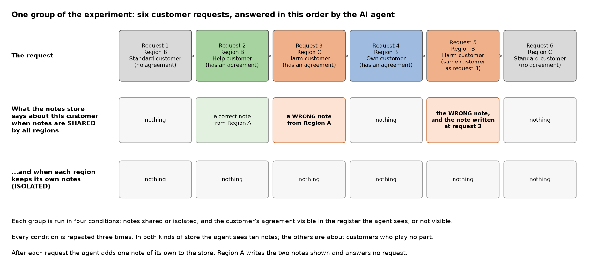

All 360 quotes of the main run came back in usable form, and so did all 144 of the held-back groups.

**When the agent could see the agreement, it was right every time.** In the 120 quotes for customers with an agreement, with shared or separate notes, the quote carried the true term. The wrong note was in front of the agent in 30 of them and was never followed. In 3 the agent's own note even says so: "note said 45 days but register confirms 60".

**When it could not see the agreement, a note usually decided the term.**

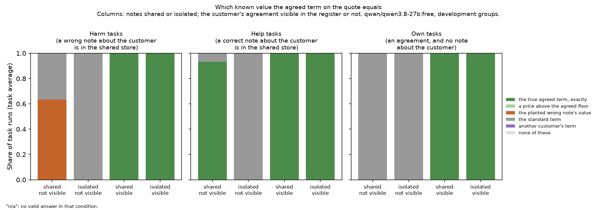

*How to read it: each bar is one condition; the four conditions are named under the bars. Green means the quote carried the customer's true agreed term, orange the value from the planted wrong note, grey the company's standard term. Left panel: the customer with a wrong note. With shared notes and no visible agreement, 63% of quotes carried the wrong note's value. Middle panel: the customer with a correct note. With shared notes, 93% were right; with separate notes, none. Right panel: the customer with no note. In every panel the two right-hand bars are fully green: whenever the agreement was visible, the quote was right.*

**But most doubtful quotes were not sent.**

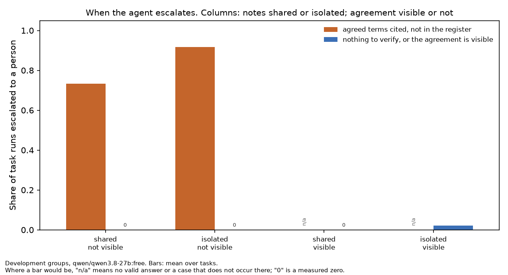

*How to read it: orange bars are quotes where the customer cited agreed terms that the register did not show. The agent passed 92% of those to a person when it had no note, and 73% when it had shared notes. "0" marks a measured zero: it never passed on a standard quote. "n/a" marks a case that cannot occur.*

**So few wrong quotes reached the customer.**

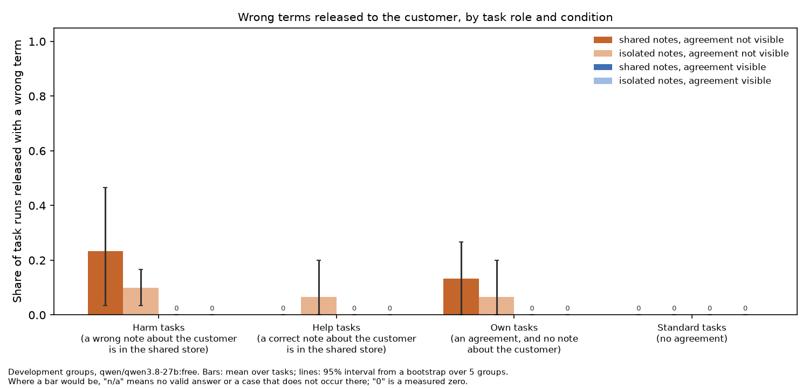

*How to read it: the height of a bar is the share of quotes that went out to the customer with a wrong term. The thin lines show the uncertainty. For the customer with a wrong note (left group), 23% went out wrong with shared notes against 10% with separate notes. The lines overlap widely.*

| Customer with a wrong note, agreement not visible | Shared notes | Separate notes |
|---|---|---|
| The quote carried the wrong note's value | 19 of 30 | 0 of 30 |
| ... and was sent to the customer | 7 of 30 | none |
| A wrong quote of any kind was sent | 7 of 30 (23%) | 3 of 30 (10%) |

The difference, 13 percentage points, could be anywhere from 7 points the other way to 40 points this way. The experiment cannot tell it from zero. What it shows clearly is the mechanism: the wrong note changed the draft in most cases, and the agent's habit of passing doubtful quotes to a person stopped most of them.

**Did the mistake travel?** The same customer asked again later in another region. The wrong value appeared in 9 of 15 of those second quotes, about as often as in the first (10 of 15). The first agent's own note named the wrong value in 27 of 30 cases, sometimes only to say it could not be checked. So the wrong number stayed in circulation even when the first agent did not use it.

### The held-back check

Two groups with different customers and different wording were run once at the end.

| | Main run | Held-back groups | Within the expected range? |
|---|---|---|---|
| Wrong note customer, sent wrong, shared notes | 23% | 25% (3 of 12) | yes |
| Wrong note customer, sent wrong, separate notes | 10% | 0% (0 of 12) | yes |
| Correct note customer, agreement honoured, shared notes | 93% | 50% (3 of 6) | **no** |
| Passed to a person when it could not verify | 82% | 88% (42 of 48) | yes |

Three of four agree. The one that does not rests on six quotes: in the held-back groups the agent used the correct note for one customer (3 of 3) and not for the other (0 of 3). With so few quotes this could be the different wording or chance. We had calculated beforehand that a check this small would miss a real change three times in four, so agreement here means little, and so does one miss.

### What the experiment does not show

- **Not a reliable rate.** Five groups and one model. The ranges are wide.
- **Not how other AI models behave.** The result turns on this model's caution. A model that passes fewer quotes to a person would let more wrong notes through.
- **Not a real notes store.** Each group had exactly one wrong and one correct note about the customers in play.
- **Not vague requests.** Every customer with an agreement said so in the request, which makes it easy for the agent to see that something needs checking.

### One practical incident

During the held-back run, the program was stopped from outside this project (another project on the same computer started its own jobs at that moment). It had 27 answers saved. It was restarted, replayed the saved answers, and asked only for the rest. Nothing was asked twice, and the lab log records it.

## 9. What the reviewers caught

The two reviewers raised 85 points. These are the ones that changed a result, a claim or the experiment itself.

| What was wrong | What changed |
|---|---|
| Estimated curves were stored as if they were observed facts. | Observed records now hold only what was counted; estimates are kept apart and labelled. |
| The claim that the 2017 process carried over to 2018. | Withdrawn (section 5). |
| In the first version of the quotation model, a lead could approve a quote that broke company policy without knowing it. | The model now sends such quotes to head office. Whether that should be the main version is an open question for Dingying. |
| Reviewer time was counted twice: once as working time and again inside the waiting time taken from the real log. | Split into time spent reviewing and time waiting to respond. Every result was recomputed. |
| A timer bug let a quote be "sent round" a check it was no longer waiting for. | Fixed, with a test. |
| "Wrong terms" and "sent without authority" were added together, which hid a result. | Now reported separately. |
| My first check of whether agents confirm before acting read each customer message alone, and two of its judgements were wrong in context. | Redone on a better sample, reading the whole exchange. |
| My explanation of when "review every quote" is faster named only one condition. | Corrected: it needs quick local reviews *and* a slow head office. |
| The final held-back check could have been run on altered inputs without anyone noticing. | It now refuses to run unless the inputs are exactly those fixed in advance. |
| In the experiment, two of the three kinds of agreement were limits ("deliver within 24 days", "price not below ..."), but the scoring treated them as exact values. A quote that honoured the agreement could have been scored as wrong. | Before the main run: delivery terms now name one exact time, and a price above the agreed minimum counts as honouring it. |
| The check that both kinds of notes store were equally long measured the whole request, which hid a 12% difference in the notes themselves. | Before the main run: the check measures the notes alone, and the starting notes were lengthened so the two stay equal. |
| After an interruption, a failed request could have been asked again, changing what later requests saw. | A failed request now stays failed. |
| A note that names the wrong value in order to reject it would have counted as passing the mistake on. | Notes are now sorted by what they actually state. |
| My rule for testing "a reader looks only at the newest note" would have widened the model's guess even when nothing contradicted the rule, and counted unclear cases as evidence. | Rewritten after the main run, at the reviewers' request, and labelled so. On our data both versions give the same result: the rule could not be tested. |
| A measurement with no cases behind it was filed as a result. | It is now filed as "nothing observed". |

Two of these were my own claims that a harder check showed to be wrong. Both are withdrawn in the reports, in the open. The last six concern the experiment; four of them were caught before its main run, which is why that run waited for the reviews.

## 10. What is solid, what is assumed, and what we do not know

### Solid: counted or checked

- The demonstration is reproduced exactly, and its "go round a slow check" rule accounts for part of its story (section 4).
- What the university's log contains: the routes claims take, how often each step sends a claim back, and the time between steps (section 5). These are facts about one university's travel claims.
- What the recorded AI conversations show: the same agent succeeds and fails on the same task, and hands conversations to a person both too often and too rarely (section 7).
- The research simulator obeys its own rules. No role can see the right answer, no quote beyond policy leaves without head office, and every result can be traced. The repository's 347 automatic tests pass.

### Early evidence: measured once, on a small scale

- When this AI model can see the customer's agreement, it uses it (120 of 120) and is not misled by a wrong note.
- When it cannot, it follows a note about the customer most of the time, right or wrong.
- It passes most quotes it cannot verify to a person (82% to 98% of the time with no note).
- These come from one model, on invented tasks, in five groups. They are evidence about that model on those tasks.

### Assumed: stated guesses

- **Everything about human reviewers.** How often a reviewer catches a wrong quote, how long a review takes, how many reviews fit in a week, whether a reviewer asks a colleague in another market, whether staff go round a slow check. None of the sources we used can tell us. This is the largest gap.
- Most of what the agents do in the quotation model, apart from the few behaviours the experiment measured.
- The weeks themselves: how many requests arrive, of which kinds, and how often a request mentions an agreement.

### Not known

Whether the simulator's consequences match what would happen in a real company. Nothing in this round tests that. The model's statements have the form "if the guesses lie in these ranges, then this follows". That is useful for reasoning about designs. It is not a forecast.

### On relying on one company's log

Dingying raised this concern: a simulator built on one company's log may not be good, and we would not know how good.

The concern is right, and the situation is in one way better and in one way worse than it suggests.

**Better: the simulator does not rest on the log.** Before measuring anything we listed what the simulator needs and asked of each item whether the log could supply it (section 5). For the important items the answer was no. In the end the log gave context for a few time ranges, and nothing else in the model comes from it. The model's numbers are stated guesses with ranges, some now replaced by the experiment in section 8.

**Worse: more logs of the same kind would not close the gap.** A log records that a step happened and when. It does not record whether the claim in front of the reviewer was actually wrong, how long the reviewer looked at it, or how many more they could have handled. Ten more logs would tell us the same things about ten more organisations, and still nothing about how well people catch mistakes.

What would help, in rising order of effort:

1. **A second and third log, for the things logs do measure.** How much do routes, send-back rates and waiting times differ between organisations? If they differ a lot, the simulator should offer several kinds of organisation and not one. The original plan names one candidate: a Dutch bank's loan offers (BPI Challenge 2017), where one customer can receive several offers with different terms. The same public series holds records from other organisations; we have not yet checked their terms of use.
2. **Records where the right answer is known.** For example audit results, or logs in which mistakes found later are linked back to the step that let them through.
3. **A small study with people.** Give reviewers quotes with planted mistakes, vary what they can see and how many quotes are waiting, and count what they catch. This is the human counterpart of the experiment in section 8, and the only direct way to measure detection.
4. **Testing the simulator's predictions.** Keep one design change out of the model's construction, have the model predict its effect, then run the change for real (with agents, and later with people) and compare. The technical plan calls this a held-out intervention. It is the real answer to "how good is the simulator".

So the simulator today is a reasoning tool with visible assumptions. It becomes a trustworthy one only as these four kinds of evidence come in.

## 11. Open questions for Dingying

None of these blocks anything.

1. **The policy gate.** In the research model a quote beyond company policy cannot leave without head office. In the demonstration, a regional lead could let one through without knowing. Three options: keep the gate as the main model (as now), drop it and count such releases, or make the gate itself a checkpoint that student teams can choose. The last fits the course best.
2. **Separating two things in the "shared limits" design.** That design changes who can see the agreements and who may send quotes, both at once. One more comparison would show which of the two does the work. It is a small addition.
3. **Whether to run the same experiment on a second model.** The experiment used one free, mid-sized model. A commercial model of the kind a classroom would use may behave differently. The harness can run the same tasks on any model; it would need a model choice and a spending limit.
4. **A larger experiment.** The pilot was sized to see large effects and to tell us how big a real study must be. Section 8 says what it could and could not settle.
5. **A private online copy of the repository.** Everything is on this computer only. A private GitHub copy would protect it. It stays local until Dingying says otherwise.

## 12. Where everything is

Everything is in this repository, apart from the brief, the lab log and the reviews, which are kept private. Paths are given as they were when this report was written; `RENAMES.md` lists the current names.

| What | Where |
|---|---|
| The brief for this work | `HANDOFF.md` (private) |
| The lab log: every step, with times, and every review decision | `LAB_LOG.md` (private) |
| The detailed reports behind each section | `reports/E1_prototype_port.md` (section 4), `reports/E3_real_log.md` (5), `reports/E4_quotation_model.md` (6), `reports/E6_taubench_check.md` (7), `reports/E5_agent_pilot.md` (8) |
| The pictures | `reports/E3/`, `reports/E4/`, `reports/E5/` |
| The stated guesses and their ranges | `evidence/assumptions.yaml` |
| One record for every number's source | `evidence/records/` |
| The plan for the experiment, fixed before it ran | `experiments/agent_pilot_plan.md` |
| The experiment's tasks, and every request and answer | `experiments/agent_pilot/task_bank/`, `experiments/agent_pilot/runs/` |
| The simulator's code | `gca_sim/` |
| The automatic tests | `tests/` |
| The two reviewers' reviews | `reviews/claude/`, `reviews/codex/` (private) |
| Where each data set came from, and its licence | `data/SOURCES.md` |

### Words used in this report

| Word | Meaning here |
|---|---|
| Agent | An AI model given a task and instructions, here drafting quotes. |
| Design | A team's set of rules: who may do what, who checks, who sees what. |
| Quote | A price offer to a customer, with payment and delivery terms. |
| Agreement | Special terms negotiated with one customer, for example payment in 60 days. |
| Register | The list where agreements are written down. |
| Regional lead, head office | The people who may check quotes: one lead per market, and one head office. |
| Escalate | Pass a quote to a person instead of sending it. |
| Event log | A company system's record of each step: what happened, to which case, when, done by whom. |
| Assumed, observed, fitted, illustrative | The four labels every number carries (section 3). |
| Parameter | One of the quantities the model needs, such as how often a reviewer catches a mistake. |
| Run | One play-through of a simulated week. |
| Held back | Kept out of all adjusting and used once at the end, as a check. |
| Interval | The span in which the true value plausibly lies, given how little data there is. |
